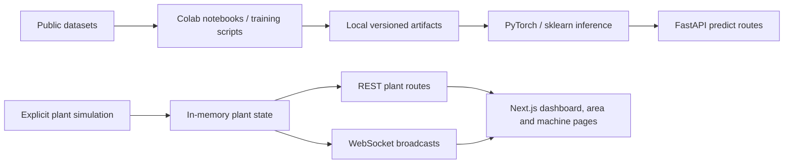

# Phase 0 architecture and compatibility inventory

| Component | Inventory status | Reuse / repair |
|---|---|---|
| FastAPI + REST + WS | EXISTING, REUSABLE | Validate input, truthful errors, preserve routes |
| Next.js/React dashboard | EXISTING, REUSABLE | Keep layout; fix unavailable states, lifecycle and zero RUL |
| Vibration 2D CNN | EXISTING, REUSABLE | Local checkpoint works; raw input contract was BROKEN |
| RUL LSTMs | EXISTING, REUSABLE | Four actual local checkpoints; fix scaling/padding |
| RUL Transformers | EXISTING, BROKEN | Notebook architecture exists; restore exact runtime architecture |
| Audio artifacts | EXISTING, BROKEN | Metrics dictionaries contain no fitted state; legitimate retraining required |
| Audio fitted baseline | NEW Phase 0 repair | Real MIMII normal training/calibration; untouched test data |
| Plant simulation/scoring | EXISTING, REUSABLE demo only | Does not establish industrial applicability or calibration |
| Regression suite | NEW | Existing tests directory was empty |
| Database/auth/OT adapters/RAG/risk V2/scheduler | NEW, NOT STARTED | Later gated phases |
| Deployment/CI | NEW, NOT STARTED | No deployment manifests existed |

## Model contracts

- **CWRU**: drive-end acceleration, dataset name specifies 48 kHz; exactly 1024 consecutive samples reshaped row-major to 32×32 then standardized per image. Local raw MAT examples numerically match NPZ images to five-significant-digit source rounding. 2048 raw samples yield two windows; inference averages their class probabilities. Ten bearing classes; softmax scores are not calibrated fault probabilities. The original recording-level independence of the split is unverified.
- **NASA C-MAPSS FD001–FD004**: simulated turbofan run-to-failure data, 80-cycle context in supplied checkpoints; 17 ordered features: op1/op2/op3 plus sensors 2,3,4,7,8,9,11,12,13,14,15,17,20,21. Standardize using saved mean/scale, truncate recent cycles or prepend zeros *after scaling*. LSTM and attention-pooling Transformer architectures retain identities. Output cycles; no validated uncertainty. Not applicable to pumps/motors/conveyors.
- **MIMII DUE baseline v1**: fan/pump/valve, sections 00/01/02, mono resampled to 16 kHz, 1–60 seconds. Whole-file mel/MFCC/spectral statistics, fitted scaler/PCA/IsolationForest per section. Score is percentile against held-out normal calibration recordings, not a probability. No recovered old audio model exists. Training/export and real evaluation are performed by scripts/train_audio.py; report all measured results, including weak performance.

## Local data and artifacts

Data/ contains 4,600 CWRU images and 10 raw MAT recordings, four C-MAPSS subsets with official test labels, and 4,209 WAV recordings per MIMII machine category (3,009 train, 600 source test, 600 target test). Local files are real dataset inputs; redistribution rights and upstream download authenticity have not been independently verified. Do not commit datasets or weights. Checksummed model bundles support explicit user-managed distribution.

There is no existing SCADA connection, PLC control API, credential configuration, production deployment, approved OEM manual corpus, LLM provider configuration, or authenticated multi-user system. Later phases must implement their own backend permissions and demonstrate simulated scenarios honestly.
