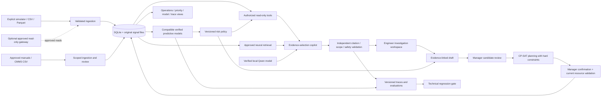

# MaintenanceAI V2 architecture

MaintenanceAI is one modular FastAPI backend and one Next.js application. The standalone demonstration uses transactional SQLite, local signal/document files, actual PyTorch/scikit-learn inference, neural document embeddings, a local language model and OR-Tools scheduling. No external MLOps, tracing, database, CMMS or industrial service is represented as deployed.

There is no arrow from the language model, scheduler or application to a PLC/actuator. Manager confirmation stores an internal schedule. It does not execute work, clear a real industrial alarm, update an external CMMS, or authorize continued machine operation.

## Modules and storage

| Concern | Actual implementation | Durable evidence |
|---|---|---|
| Identity and scope | PBKDF2 passwords, hashed expiring sessions, backend plant/asset/source/document grants | `users`, grants, `sessions`, `audit_events` |
| Integration | Simulation, bounded CSV/Parquet imports, optional read-only OPC UA/historian adapters | `assets`, `sensors`, `telemetry`, ingestion events, alarms |
| Predictive ML | Preserved CWRU/MIMII/C-MAPSS models; separately trained synthetic conveyor model | verified model manifests, inputs/hashes, versions/bindings, predictions, activation history |
| Risk | Configurable consequence and degradation rules; explicit insufficient evidence | immutable assessments, versioned policies and criticality profiles |
| Copilot | MiniLM exact-vector retrieval plus Qwen3 evidence selection and backend grounding | originals, document approval, chunks/embeddings, sessions, citations, investigations |
| LLMOps | Local trace/evaluation system equivalent; content-addressed configurations and release decisions | traces, feedback, evaluation runs, declared reviews, release records |
| Planning | Immutable work drafts, approved candidates, bounded CP-SAT and independent validation | resource versions, proposal snapshots, manager decisions, confirmed reservations |
| Administration | Scoped local identities, revocation, file sources, asset/sensor contracts, audit view | transactional registry/grants and audit events |

Migrations run in lexical order within a transaction. UTC timestamps and immutable identifiers are used throughout. Signal files and original documents are stored beside the configured database. A database backup alone is insufficient: preserve associated files and matching model manifests/artifacts together.

The local SQLite registry implements model identity, preprocessing/dataset compatibility, comparison experiments, plant-scoped champion/challenger activation, monitoring and rollback. The local SQL trace/evaluation system implements the required LLMOps responsibilities. Neither is described as an MLflow or Langfuse deployment. Exact SQLite vector search and a single application process are suitable for the bounded local demonstration; fleet-scale load testing, distributed jobs and industrial availability engineering remain outside the validated scope.

## Evidence types and trust

1. Public-dataset recordings are real measurements from those datasets, with their original scope and provenance limitations.
2. Predictions are actual executions of verified learned artifacts. A model's supported dataset binding and operating conditions are checked before inference.
3. Conveyor process measurements and alarm events are explicitly simulated. A selected scenario label is not the learned classification or a confirmed physical fault.
4. Maintenance history and the DEMO-2 guide are authored synthetic references. They are never presented as OEM instructions or real work completion.
5. Schedules use simulated resource calendars and disruption units. Only a human manager can confirm them internally.

Approved document content remains untrusted as instructions to the model. The model selects bounded evidence identifiers; backend code checks roles, applicability, current access and literal/computed claim grounding. Unsupported RUL, absent measurements, stale models and missing manuals produce explicit limitations or abstention. Cost and validated predictive uncertainty are unknown where not measured.

## Product navigation

`/operations` connects telemetry, sensor quality, alarms, model outputs, current risk, investigation, work orders and upcoming approved maintenance. `/operations/risks` shows risk explanations and planning status. `/operations/scheduling` handles resources, candidates and approval. `/operations/models`, `/operations/documents`, `/operations/observability` and `/operations/admin` provide the model, evidence, trace and access-management views.

The original `/plant/*`, `/predict/*` and legacy WebSocket routes remain an isolated public local simulation/reference-dataset interface. They do not bypass V2 industrial data permissions or interact with real equipment. Production exposure would require a separate review and deployment boundary; the verified launcher binds both services only to loopback.

See [scheduling details](SCHEDULING.md), [risk policy](RISK_POLICY.md), [copilot grounding](COPILOT.md), [LLMOps](LLMOPS.md), [security boundaries](../security/SECURITY.md) and [local deployment](../deployment/LOCAL_DEMO.md).
